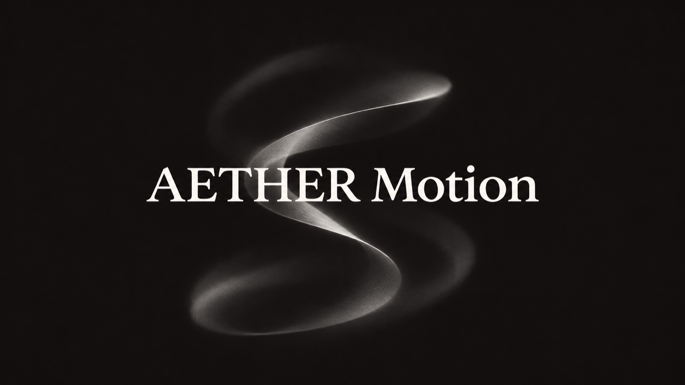

<h1 align="center"></h1>

<p align="center"><b>Write HTML. Render video. No browser.</b></p>

<p align="center">
  <a href="https://github.com/ferxalb/aether-motion/actions/workflows/ci.yml"></a>
  <a href="https://github.com/ferxalb/aether-motion/releases"></a>
  <a href="https://skills.sh/ferxalb/aether-motion"></a>
  <a href="LICENSE"></a>
  
  
</p>

<p align="center">
  <a href="#quick-start">Quick Start</a> |
  <a href="#blocks-and-themes">Blocks</a> |
  <a href="examples">Examples</a> |
  <a href="AGENTS.md">Composition Reference</a> |
  <a href="#agent-skills">Agent Skills</a> |
  <a href="https://github.com/ferxalb/aether-motion/releases">Download</a>
</p>

AETHER Motion is a free, open-source video renderer that turns HTML and CSS compositions into deterministic MP4 videos. It is a single native binary: no headless Chrome, no Node.js, no FFmpeg. It reads the HyperFrames composition format (clips, tracks, and timing as data attributes) and adds native motion: keyframes, camera moves, kinetic type, scene transitions, and glass.

Using a coding agent? Connect the local MCP server for direct tool access, or install the AETHER Motion Agent Skills for reusable composition, rendering, SVG, and import workflows.

## Quick Start

```bash
npx @aether-motion/cli init my-video    # or: pnpm dlx / bunx / yarn dlx (no install needed)
```

With the binary on your `PATH` (`npm i -g @aether-motion/cli`, a [release download](https://github.com/ferxalb/aether-motion/releases), or `cargo install`), the commands are short:

```bash
aether-motion init my-video   # sample video + agent skills + MCP config, ready to go
cd my-video
aether-motion preview         # render a frame and open it (add --watch to refresh on save)
aether-motion render          # export out/index.mp4
```

`init` writes `aether.json`, a sample `index.html`, project `AGENTS.md`, the bundled Agent Skills (`.claude/skills`, `.agents/skills`), and the MCP server entry for Claude Code (`.mcp.json`; Cursor and VS Code too when their folders exist or with `--all`). It never overwrites existing files without `--force`, merges into existing MCP files, and is safe to re-run. Other commands: `check`, `add [block]`, `captions`, `agent setup|status`, `doctor`. `aether-motion --help` lists every command by task, and `aether-motion help <command>` (or `<command> --help`) shows its options, defaults, and examples.

### With an AI coding agent

Install AETHER Motion (see [Install](#install)), then register its MCP server. For Claude Code:

```bash
claude mcp add aether-motion -- aether-motion mcp
```

For other agents, add `aether-motion mcp` as a stdio MCP server in their settings.

The server supports MCP `2026-07-28` and legacy clients that begin with `initialize`.

Try a prompt like:

> Using the AETHER Motion tools, make a 12-second 1080p product intro with a kinetic title, three glass feature cards, an animated counter, and a push transition between scenes.

The agent reads the contract with `aether_guide`, writes the file, validates it with `aether_check` (which returns the exact error and a fix), looks at any moment with `aether_snapshot`, and exports with `aether_render`.

### Manually with the CLI

```bash
aether-motion check  examples/premium-promo.html                                       # validate
aether-motion render examples/premium-promo.html --output frame.png --frame 90         # preview a frame
aether-motion render examples/premium-promo.html --output promo.mp4 --size 1080p --fps 30
aether-motion render examples/variables.html --output q4.mp4 --variables-file examples/variables.json   # same template, new values
```

**Requirements:** none. FFmpeg is optional (`--encoder ffmpeg`).

## Install

Download the binary for your system from [Releases](https://github.com/ferxalb/aether-motion/releases) and put `aether-motion` on your `PATH`. Or build it with Rust:

```bash
cargo install --git https://github.com/ferxalb/aether-motion
```

From a local checkout, run `cargo install --path . --locked`.

## How It Works

Define a video as HTML. Data attributes set timing and tracks; `data-hf-*` attributes and CSS `@keyframes` add motion.

```html
<div id="stage" data-composition-id="launch" data-width="1920" data-height="1080"
     data-duration="6" style="position: relative; background: #0b1020">

  <div id="intro" class="clip" data-start="0" data-duration="3" data-track-index="0"
       style="position: absolute; left: 0; top: 0; width: 100%; height: 100%">
    <div data-hf-camera='[{"at":0,"zoom":1},{"at":3,"zoom":1.15,"easing":"ease-out-expo"}]'
         style="position: absolute; left: 0; top: 0; width: 100%; height: 100%;
                display: flex; align-items: center; justify-content: center">
      <h1 data-hf-split="words" data-hf-split-from="up"
          style="color: white; font-family: sans-serif; font-size: 120px">Launch day</h1>
    </div>
  </div>

  <div id="outro" class="clip" data-start="intro-0.6" data-duration="3.6" data-track-index="1"
       data-hf-transition="push-left" data-hf-transition-from="intro"
       style="position: absolute; left: 0; top: 0; width: 100%; height: 100%; background: #12203d;
              display: flex; align-items: center; justify-content: center">
    <div data-hf-counter="12400" data-hf-counter-suffix="+"
         style="color: #4ee0b5; font-family: sans-serif; font-size: 160px; font-weight: bold"></div>
  </div>
</div>
```

AETHER Motion parses the composition, lays it out, and draws every frame with its own software renderer, then encodes H.264 with a built-in encoder. Each frame is a function of time only, so the same input produces the same video on every run. Anything outside the supported subset fails with an explicit error instead of rendering something wrong.

<p align="center">
  
</p>
<p align="center">
  Rendered with AETHER Motion from the <a href="examples/aether-monochrome-promo.html">monochrome promo composition</a>.
</p>

## Blocks and Themes

Ready-made, parametrized pieces, printed as editable HTML:

```bash
aether-motion block list
aether-motion block hero-title --set title="Launch day" --set id=intro
aether-motion block theme-midnight
```

The [premium promo](examples/premium-promo.html) combines titles, feature cards, counters, and a closing call to action. Use `aether-motion block list` for the current catalog and parameter defaults.

## Examples by feature

| Feature | Composition |
| --- | --- |
| Reusable scenes and a match dissolve | [One Night](examples/one-night/index.html) |
| Subject tracking and shot presets | [Camera rig](examples/cinematic-camera-rig-6s.html) |
| 2.5D planes and a perspective camera | [Lantern Valley](examples/depth-lantern-valley.html) |
| Native low-poly 3D: meshes, lights, a 3D camera | [Lighthouse Isle](examples/lighthouse-isle-3d.html) |
| Parallax, image sequences, and bloom | [The Morning Shift](examples/cinematic-dystopia.html) |
| Wrapped kinetic typography | [Kinetic text](examples/kinetic-wrap.html) |
| Word-highlighted captions | [Captions](examples/captions.html) |
| Video and audio speed ramps | [Speed ramps](examples/speed.html) |
| Volume automation, EQ, and ducking | [Audio effects](examples/audio-effects.html) |
| Reusable templates with typed inputs | [Variables](examples/variables.html) |

## Output

| Composition | `--size 1080p` | `--size 4k` |
| --- | --- | --- |
| Landscape (16:9) | 1920 × 1080 | 3840 × 2160 |
| Vertical (9:16) | 1080 × 1920 | 2160 × 3840 |

Native MP4 exports use H.264 at up to 60 fps with limited-range BT.709 yuv420p. Use `--quality draft|standard|high|max` to set compression. Use `--frame N` for a PNG still.

## Documentation

- Supported HTML, CSS, and motion attributes ([Composition reference](AGENTS.md), [Limits](limits.md))
- Importing, fitting, and reusing scenes ([Motion Scenes](docs/motion-scenes.md))
- Native 3D scenes, cameras, lights, backends, and limits ([3D](docs/3d.md))
- Source layout, resource limits, and rendering internals ([Architecture](docs/architecture.md))
- Performance measurements and methods ([Benchmarks](BENCHMARK.md))
- Release history and publishing workflow ([Changelog](CHANGELOG.md), [Release process](docs/releasing.md))

## Agent skills

Install the skill collection with `npx skills add ferxalb/aether-motion`, then select the workflows you want to add to your agent. The MCP server and Agent Skills are complementary: MCP exposes AETHER Motion tools, while the skills teach an agent how to use the composition contract and workflows.

| Skill | Use it for |
| --- | --- |
| `aether-motion` | Creating and editing compositions |
| `aether-motion-cinematic` | Directing consistent, cinematic scenes, characters, and camera work |
| `aether-motion-3d` | Building native low-poly 3D shots: meshes, lights, and a 3D camera |
| `aether-motion-cli` | Checking, inspecting, and rendering compositions |
| `aether-motion-blocks` | Finding and adapting ready-made blocks and themes |
| `aether-motion-svg` | Creating and placing static SVG artwork |
| `aether-motion-import` | Porting existing HyperFrames or Remotion projects |

## Contributing

```bash
cargo build --release
cargo test --release <test-name>
```

CI builds and tests on Linux, macOS, and Windows. Read [AGENTS.md](AGENTS.md) for code organization and CPU budget rules before profiling or benchmarking.

- Bugs and feature requests: [GitHub Issues](https://github.com/ferxalb/aether-motion/issues)

## License

[Apache 2.0](LICENSE). Includes Roboto (Apache 2.0). Audio uses Symphonia (MPL-2.0) for decoding and `oxideav-aac` (MIT) for AAC encoding; AAC and MP3 are patent-licensed formats, so check your distribution needs.
