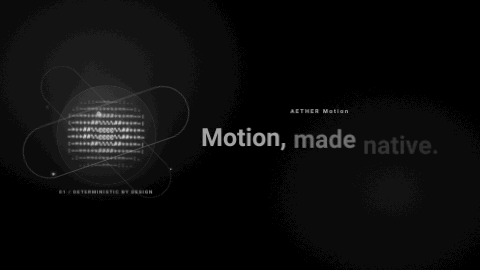

<h1 align="center"></h1>

<p align="center"><b>Write HTML. Render video. No browser.</b></p>

<p align="center">
  <a href="https://github.com/ferxalb/aether-hyperframes/actions/workflows/ci.yml"></a>
  <a href="https://github.com/ferxalb/aether-hyperframes/releases"></a>
  <a href="LICENSE"></a>
  
  
</p>

<p align="center">
  <a href="#quick-start">Quick Start</a> |
  <a href="#blocks-and-themes">Blocks</a> |
  <a href="examples">Examples</a> |
  <a href="AGENTS.md">Composition Reference</a> |
  <a href="https://github.com/ferxalb/aether-hyperframes/releases">Download</a>
</p>

AETHER Motion is a free, open-source video renderer that turns HTML and CSS compositions into deterministic MP4 videos. It is a single native binary: no headless Chrome, no Node.js, no FFmpeg. It reads the HyperFrames composition format (clips, tracks, and timing as data attributes) and adds native motion: keyframes, camera moves, kinetic type, scene transitions, and glass.

Using Claude Code, Codex, Cursor, or another coding agent? Connect `aether-motion mcp`, then ask your agent to make a video.

## Quick Start

### With an AI coding agent

Install AETHER Motion (see [Install](#install)), then register its MCP server. For Claude Code:

```bash
claude mcp add aether-motion -- aether-motion mcp
```

For other agents, add `aether-motion mcp` as a stdio MCP server in their settings.

Try a prompt like:

> Using the AETHER Motion tools, make a 12-second 1080p product intro with a kinetic title, three glass feature cards, an animated counter, and a push transition between scenes.

The agent reads the contract with `aether_guide`, writes the file, validates it with `aether_check` (which returns the exact error and a fix), looks at any moment with `aether_snapshot`, and exports with `aether_render`.

### Manually with the CLI

```bash
aether-motion check  examples/premium-promo.html                                       # validate
aether-motion render examples/premium-promo.html --output frame.png --frame 90         # preview a frame
aether-motion render examples/premium-promo.html --output promo.mp4 --size 1080p --fps 30
```

**Requirements:** none. FFmpeg is optional (`--encoder ffmpeg`).

## Install

Download the binary for your system from [Releases](https://github.com/ferxalb/aether-hyperframes/releases) and put `aether-motion` on your `PATH`. Or build it with Rust:

```bash
cargo install --git https://github.com/ferxalb/aether-hyperframes
```

Earlier release archives use the executable name `aether-hyperframes`. From a local checkout, run `cargo install --path . --locked` to install `aether-motion` before the next release.

## What You Can Build

- Product launch videos and feature announcements
- Metric and milestone videos with animated counters and stat cards
- Kinetic title cards and lower thirds
- Vertical (9:16) social videos at 1080p or 4K
- Automated video in CI and content pipelines, with output identical on every run

## How It Works

Define a video as HTML. Data attributes set timing and tracks; `data-hf-*` attributes and CSS `@keyframes` add motion.

```html
<div id="stage" data-composition-id="launch" data-width="1920" data-height="1080"
     data-duration="6" style="position: relative; background: #0b1020">

  <div id="intro" class="clip" data-start="0" data-duration="3" data-track-index="0"
       style="position: absolute; left: 0; top: 0; width: 100%; height: 100%">
    <div data-hf-camera='[{"at":0,"zoom":1},{"at":3,"zoom":1.15,"easing":"ease-out-expo"}]'
         style="position: absolute; left: 0; top: 0; width: 100%; height: 100%;
                display: flex; align-items: center; justify-content: center">
      <h1 data-hf-split="words" data-hf-split-from="up"
          style="color: white; font-family: sans-serif; font-size: 120px">Launch day</h1>
    </div>
  </div>

  <div id="outro" class="clip" data-start="intro-0.6" data-duration="3.6" data-track-index="1"
       data-hf-transition="push-left" data-hf-transition-from="intro"
       style="position: absolute; left: 0; top: 0; width: 100%; height: 100%; background: #12203d;
              display: flex; align-items: center; justify-content: center">
    <div data-hf-counter="12400" data-hf-counter-suffix="+"
         style="color: #4ee0b5; font-family: sans-serif; font-size: 160px; font-weight: bold"></div>
  </div>
</div>
```

AETHER Motion parses the composition, lays it out, and draws every frame with its own software renderer, then encodes H.264 with a built-in encoder. Each frame is a function of time only, so the same input produces the same video on every run. Anything outside the supported subset fails with an explicit error instead of rendering something wrong.

<p align="center">
  
</p>
<p align="center">
  Rendered with AETHER Motion from the <a href="examples/aether-monochrome-promo.html">monochrome promo composition</a>.
</p>

## Blocks and Themes

Ready-made, parametrized pieces, printed as editable HTML:

```bash
aether-motion block list
aether-motion block hero-title --set title="Launch day" --set id=intro
aether-motion block theme-midnight
```

| Block | What it is |
| --- | --- |
| `hero-title` | Full-screen hero: kicker, word-by-word headline, subtitle |
| `feature-card` | Glass card with accent dot, title, and body |
| `stat-card` | Big value that pops in letter by letter, with a label |
| `counter-card` | Number that counts up, with prefix or suffix and a label |
| `cta` | Closing headline, gradient button, and URL |
| `glow` | Two soft, slowly drifting background glows |
| `theme-midnight`, `theme-sunrise`, `theme-paper` | Recolor every block at once |

[`examples/premium-promo.html`](examples/premium-promo.html) is a 15-second promo built from blocks.

## Why AETHER Motion?

- **One binary:** no browser, no Node.js, no FFmpeg. Runs on macOS, Linux, and Windows, including CI runners and servers.
- **Deterministic:** same input, same frames, same output. Generic fonts use an embedded Roboto, so text matches across machines.
- **Honest errors:** unsupported HTML or CSS returns the exact problem and a suggested fix, never a silently wrong video.
- **Native motion:** keyframes with expo, back, and `cubic-bezier` easing, CSS `@keyframes`, camera zoom and pan, kinetic text, reveals, counters, and crossfade, push, cover, wipe, and zoom transitions.
- **Polished look:** flexbox, text wrapping, gradients, layered and inset shadows, blur, frosted glass, rotation, vignette, and film grain.
- **Easy on your machine:** renders at low priority on a quarter of your cores by default. `--threads N` goes faster; `--scale 0.5` gives quick drafts.
- **Fast:** the 15-second premium promo (450 frames at 1080p/30) renders to MP4 in about 15 seconds with default settings on a laptop. See [BENCHMARK.md](BENCHMARK.md).
- **Open source:** Apache 2.0.

## AETHER Motion vs HyperFrames

AETHER Motion uses the [HyperFrames](https://github.com/heygen-com/hyperframes) composition format but replaces the browser pipeline with a native renderer. Pick the one that fits the job:

| | **AETHER Motion** | **HyperFrames** |
| --- | --- | --- |
| Rendering | Native Rust renderer | Headless Chrome + FFmpeg |
| Install | One binary | Node.js 22+, Chrome, FFmpeg |
| HTML/CSS coverage | Documented subset; anything else fails with an error | Everything a browser can render |
| Animation | Native keyframes, camera, text, transitions, CSS `@keyframes` | GSAP, CSS, Lottie, Three.js, WAAPI, adapters |
| Video, audio, SVG, scripts | Not supported | Supported |
| Agent integration | MCP server | Agent skills and CLI |
| License | Apache 2.0 | Apache 2.0 |

Use AETHER Motion when you want a lightweight, dependency-free, reproducible render of motion graphics. Use HyperFrames when you need media, audio, scripts, or full browser CSS.

## Output

| Composition | `--size 1080p` | `--size 4k` |
| --- | --- | --- |
| Landscape (16:9) | 1920 × 1080 | 3840 × 2160 |
| Vertical (9:16) | 1080 × 1920 | 2160 × 3840 |

Up to 60 fps, H.264 MP4 (yuv420p, constant frame rate), or a single PNG frame with `--frame N`.

## Documentation

- [Composition reference](AGENTS.md): every supported attribute, CSS property, and motion feature
- [Limits](limits.md): what is not supported
- [Examples](examples): ready-to-render compositions
- [Architecture](docs/architecture.md): source layout, memory limits, encoding
- [Benchmarks](BENCHMARK.md): measurements and method
- [Changelog](CHANGELOG.md): releases (SemVer; while `0.x`, minor releases may break the contract, and every break is listed)

## Contributing

```bash
cargo build --release
cargo test --release <test-name>
```

CI builds and tests on Linux, macOS, and Windows. Read [AGENTS.md](AGENTS.md) for code organization and CPU budget rules before profiling or benchmarking.

- Bugs and feature requests: [GitHub Issues](https://github.com/ferxalb/aether-hyperframes/issues)

## License

[Apache 2.0](LICENSE). Includes Roboto (Apache 2.0).

AETHER Motion is an independent project and is not affiliated with HeyGen or the HyperFrames project.
